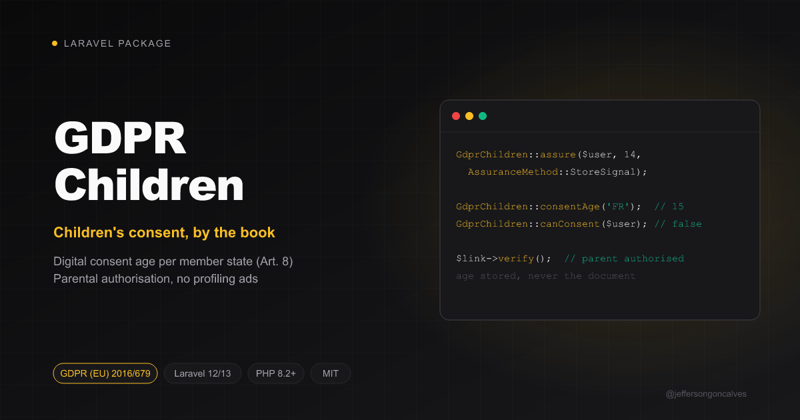

# Laravel GDPR Children



[](https://packagist.org/packages/jeffersongoncalves/laravel-gdpr-children)
[](https://github.com/jeffersongoncalves/laravel-gdpr-children/actions/workflows/tests.yml)
[](https://packagist.org/packages/jeffersongoncalves/laravel-gdpr-children)

Children's consent for the EU General Data Protection Regulation (GDPR, Art. 8). It is part of the [laravel-gdpr](https://github.com/jeffersongoncalves/laravel-gdpr) suite.

When an online service relies on consent and offers it directly to a child, the child can only consent alone from the age of digital consent: 16 by default, lowered by some member states to as little as 13. Below that age, consent must be given or authorised by the holder of parental responsibility. You must make reasonable efforts to verify that (Art. 8(2)).

- **Age checks as results only:** you store the age, the method and the provider. The document, selfie or birth date used to reach it is never stored (data minimisation). Results expire, so users are checked again over time.
- **One age per user:** reliable checks outweigh self-declaration, and the youngest reliable result wins.
- **Consent age per country:** the default is 16, with a table of member state ages that you can override.
- **Parental authorisation:** a verified guardian link. `canConsent()` tells you whether a consent given by this user counts.
- **No profiling-based ads for minors:** `allowsProfiling()` and `@gdprProfiling` only let verified adults through (Digital Services Act, Art. 28(2)).
- **Adult-only routes:** the `gdpr.adult` middleware requires a reliable adult result.

> This package gives you tooling. It does not make you compliant on its own. The national consent ages in the config are a starting point: check the current law of the countries you serve.

## Installation

```bash
composer require jeffersongoncalves/laravel-gdpr-children
php artisan vendor:publish --tag="gdpr-children-migrations"
php artisan migrate
php artisan vendor:publish --tag="gdpr-children-config"   # optional
```

## Usage

```php
use JeffersonGoncalves\GdprChildren\Enums\AssuranceMethod;
use JeffersonGoncalves\GdprChildren\Facades\GdprChildren;

GdprChildren::assure($user, 14, AssuranceMethod::StoreSignal);

GdprChildren::age($user);                          // 14
GdprChildren::consentAge('IT');                    // 14
GdprChildren::needsParentalConsent($user);         // true: below the default 16
GdprChildren::needsParentalConsent($user, 'IT');   // false
```

Before you rely on a consent (for example with [laravel-gdpr-consent](https://github.com/jeffersongoncalves/laravel-gdpr-consent)):

```php
if (! GdprChildren::canConsent($user, $user->country)) {
    // ask a parent: send them a verification link, then link and verify them
}
```

The methods are `self_declaration`, `os_signal`, `store_signal`, `document`, `facial_estimation`, `verifiable_credential` and `guardian`. You choose which ones count as reliable in `reliable_methods`, and how long each one is valid in `valid_for`. The stored age is the age at the time of the check; the current age adds the whole years since then.

A user with no valid result has an unknown age. While `likely_access` is true (the default), unknown users are treated as children: they need parental consent and get no profiling-based ads.

### Parental authorisation

```php
$link = GdprChildren::link($child, $parent, 'mother');   // pending
$link->verify();                                         // after your verification step

GdprChildren::canConsent($child);    // true
GdprChildren::guardians($child);     // Collection of parent models
$link->revoke();
```

### Ads and adult content

```blade
@gdprProfiling
    <script src="https://ads.example.com/pixel.js"></script>
@endgdprProfiling
```

```php
Route::get('/adult', AdultController::class)->middleware(['auth', 'gdpr.adult']);
```

Users without a reliable adult result get a 403. To send them to your age check instead, set `verify_route` to that route's name.

### Report

```bash
php artisan gdpr:children          # users below the default consent age without a verified guardian
php artisan gdpr:children --json
```

The command exits with 1 when something needs attention.

## Testing

```bash
composer test
```

## Changelog

See [CHANGELOG](CHANGELOG.md).

## License

The MIT License (MIT). See [License File](LICENSE.md).
